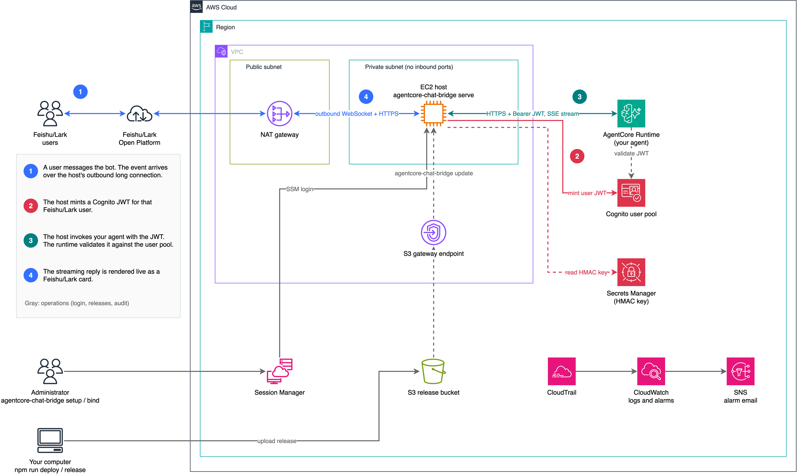

English | [简体中文](README_CN.md)

# Chat integration with Feishu/Lark for Amazon Bedrock AgentCore

This sample is a self-hosted Feishu/Lark integration for agents that already run on Amazon Bedrock AgentCore Runtime. Agents on AgentCore Runtime have no built-in chat interface. The sample provides one by running a bridge service on an EC2 host in your account: it keeps an outbound long connection to Feishu, maps each Feishu user to a Cognito identity, calls your runtime with that user's JWT, and renders the streaming reply live as a Feishu card.

**You bring the agent.** The sample does not deploy or host an agent for you. It binds to an existing AgentCore runtime (written with Strands Agents, the supported framework) whose authorizer is JWT pointing at the sample's Cognito user pool. [`examples/strands-agent/`](examples/strands-agent/) is a reference agent you can deploy to try it out.

> **Third-party service.** This code interacts with Feishu (and its international edition, Lark), which has terms published at https://www.feishu.cn/terms (Lark: https://www.larksuite.com/user-terms-of-service) and pricing described at https://www.feishu.cn/pricing (Lark: https://www.larksuite.com/pricing). You should be familiar with the pricing and confirm that your use case complies with the terms before proceeding.

> **Sample code disclaimer.** This project is a sample that shows how to connect an agent on AgentCore Runtime to Feishu/Lark. It is not a production-ready product. Before using it in production, review it against your organization's security and compliance requirements (identity and permissions, data retention, logging, networking, dependency vulnerability scanning, and so on).

- Design document: [`docs/design.md`](docs/design.md)
- Reference agent: [`examples/strands-agent/`](examples/strands-agent/)
- Agent development guide (requirements an agent must meet to work with this bot, and how to write each capability): [`docs/agent-guide.md`](docs/agent-guide.md)

## Architecture



1. A user messages the bot in Feishu/Lark. The event arrives over a WebSocket long connection that the host opens outbound through the NAT gateway. The host has no public IP and no inbound ports.
2. The host maps the Feishu user to a Cognito user (the password is derived from an HMAC key in Secrets Manager) and gets a short-lived access token for that user.
3. The host calls your AgentCore runtime over HTTPS with the token as a Bearer JWT and reads the reply as a server-sent event (SSE) stream. The runtime validates the token against the Cognito user pool, and your agent reads the user identity from it.
4. The host renders the stream live as a Feishu/Lark card.

Operations: administrators log in to the host with SSM Session Manager to run `agentcore-chat-bridge` commands. Release packages are uploaded from your computer to an S3 bucket, and the host fetches them through an S3 gateway endpoint. CloudTrail feeds CloudWatch alarms on the token-minting Cognito APIs, and the alarms notify you through SNS email.

(The diagram shows the runtime call as a direct line. It also leaves the VPC through the NAT gateway.)

## Features

**Registration and binding**

- `agentcore-chat-bridge setup` registers a Feishu bot with the official device-code authorization: one QR scan creates the app with its permissions, events, and card callbacks prefilled. The person who scans becomes the administrator.
- One host serves several bots. Each bot can bind several AgentCore runtimes (by ARN and endpoint qualifier) under aliases. Administrators switch between them with `/agent`. One runtime can also be bound by several bots.
- `bind --verify` checks the runtime's authorizer configuration before a binding goes live. New bots load without a service restart.
- `/newbot` registers another bot from inside Feishu that reuses the current agent.

**Conversation**

- Direct messages, and group chats where the bot is @-mentioned.
- Input: text, rich text, quoted replies, images, files (up to 20 MB each, 50 MB and 5 files per turn by default), and merged-forward chat history.
- Streaming card: the reply is rendered as it is generated, with a collapsible reasoning panel, the list of tool calls, token usage, a **Regenerate** button, and a **View trace** button that opens AgentCore Observability in the CloudWatch console.
- Human confirmation: when the agent raises a Strands interrupt before a sensitive tool call, the card shows option buttons, and the click resumes the agent.
- Sessions: each user has their own AgentCore runtime session. `/new` starts a new conversation, `/resume` switches back to a recent one, and `/retry` resends the last message. Turns in one session run one at a time, and later messages queue.
- The agent receives the user's display name and a stable user ID (`feishu:<tenant_key>:<union_id>`, carried in the verified JWT) so it can personalize replies and isolate per-user data such as AgentCore Memory.

**Administration**

- Access control: administrators and an allowlist (by union_id, email, or mobile number), or `allowAll`. When someone who is not on the list messages the bot, the administrators get an access-request card with **Allow** / **Deny** buttons.
- Scheduled tasks: `/schedule add weekdays 09:00 <prompt>` runs a prompt on a schedule and posts the result to the chat.
- Usage statistics per bot and agent: turns, success rate, active users, tokens, and latency (`/usage` in Feishu, `agentcore-chat-bridge usage` on the host).
- Host operations: `status`, `logs`, `restart`, verified in-place upgrades (`update`), and HMAC secret rotation without downtime (`rotate-secret`).

**Security**

- No inbound ports and no public IP. Logins go through SSM Session Manager only.
- A separate Cognito app client for each binding, and 15-minute access tokens.
- The instance role is scoped to this project's user pool, secret, and release bucket. Calling the runtime needs no IAM permission.
- Logs never contain message text, file names, AppSecrets, or tokens.

## Prerequisites

- An AWS account and region. The agent runtime must be in the **same account and region** as the bot host.
- The runtime's authorizer must be **JWT pointing at this project's Cognito user pool** (see "Configure the runtime" below). Runtimes with IAM authorization are not supported.
- On your machine: Node.js 24+, credentials for AWS CDK, `gpgv` (verifies the Node.js release signature; on macOS: `brew install gnupg`), the AWS CLI, and the Session Manager plugin.
- A Feishu enterprise tenant. The person who scans the QR code needs permission to create self-built apps.

## Cost

Deployment creates the following billable resources. Actual cost depends on the region, usage, and how long you keep them, so estimate it for your scenario with the [AWS Pricing Calculator](https://calculator.aws/):

- An EC2 `t4g.small` instance (always on), a 20 GB encrypted gp3 root volume, and EBS snapshots taken daily with 7 retained.
- A NAT Gateway (one is created when you do not pass `vpcId`; it is billed per hour and per GB of traffic and is usually the largest fixed cost). It is not created when you reuse an existing VPC.
- A Cognito user pool (Essentials plan, billed per monthly active user), a Secrets Manager secret, an S3 release bucket, an S3 bucket for server access logs (kept 90 days), and CloudWatch logs and alarms.
- VPC flow logs for rejected traffic (only for a VPC created by the stack), kept 30 days in CloudWatch Logs.
- CloudTrail: when you do not pass `trailLogGroupName`, a trail that records management events only is created, together with its S3 bucket and log group.
- The cost of the agent runtime itself (AgentCore Runtime, model invocations, and so on) is not part of this project.

When you no longer need it, delete the resources as described in "Clean up".

## Deploy

```bash
npm ci && npm --prefix infra ci
npm run deploy          # = npm run release (build the package) + cdk deploy (run cdk bootstrap first if needed)
```

Optional `cdk deploy` context values (`-c key=value`):

| key | Description |
|---|---|
| `vpcId` | Reuse an existing VPC (it needs a private subnet with NAT egress and an S3 gateway endpoint). A new VPC is created when omitted |
| `releaseWriterArns` | IAM principals allowed to write to the release bucket (comma separated), used by `npm run release -- --upload` |
| `alarmEmail` | Email address for alarms |
| `trailLogGroupName` | Log group of an existing CloudTrail to reuse. A new trail that records management events only is created when omitted |

The deployment outputs include `SsmCommand`, `UserPoolId`, `DiscoveryUrl`, and `ReleaseBucketName`.

## Register a bot

```bash
aws ssm start-session --target <instance ID>             # the SsmCommand output
agentcore-chat-bridge setup [--runtime-arn <arn>] [--app-name NAME]
```

A QR code (and a link) is shown in the terminal; scan it with the Feishu app and confirm. `setup` uses the official SDK device-code authorization (`registerApp`), which creates the app with the permissions, events, and card callbacks from [`setup/scopes.json`](setup/scopes.json) prefilled, and returns the AppID / AppSecret. `setup` then checks the credentials, makes the person who scanned the administrator (stored as `union_id`), and runs the first phase of binding.

After `setup`, open the app in the Feishu Open Platform (the link is printed) and confirm that the event and callback subscription mode is "long connection", that a version is published, and that the permissions are granted. Then `agentcore-chat-bridge status` should show the long connection as connected.

If you created the app by hand in the Open Platform instead, register it with `setup --verify <appId>` (you are asked for the AppSecret).

By default a new app is visible only to the person who scanned, and only the administrator can chat. Adjust the visibility range in the Open Platform. In `/var/lib/agentcore-feishu-bot/bots.json` configure `allowedUsers` (union_id) or `allowAll: true`, then run `agentcore-chat-bridge restart`.

## Configure the runtime (customer side)

`setup` / `bind` creates a new Cognito app client for every binding and prints the configuration the runtime needs:

```jsonc
"authorizerConfiguration": {
  "customJWTAuthorizer": {
    "discoveryUrl": "https://cognito-idp.<region>.amazonaws.com/<userPoolId>/.well-known/openid-configuration",
    "allowedClients": ["<app client id of this binding>"]
  }
},
"requestHeaderConfiguration": { "requestHeaderAllowlist": ["Authorization"] }
```

After applying it with `UpdateAgentRuntime` (or the AgentCore CLI), run on the host:

```bash
agentcore-chat-bridge bind --verify <appId> [alias]     # the binding becomes "ready" once the checks pass
```

> **Migration guidance.** JWT authorization and IAM authorization on a runtime are **mutually exclusive**. After switching to JWT, new versions no longer accept SigV4 calls (the authorizer configuration is fixed per version, tested). If other programs still call it with IAM:
> 1. **Recommended:** create a separate JWT-authorized runtime from the same image for the bot and leave the original runtime alone.
> 2. Transition: first create an endpoint pinned to the current version and switch the IAM callers to it, then change the runtime to JWT. The pinned endpoint's code is frozen at that version.
>
> The tool never modifies your runtime for you.

The agent reads the access token from `context.request_headers["Authorization"]` and uses its `username` (= `feishu:<tenant_key>:<union_id>`) as the user identity. Do not trust `actorId` in the payload. See [`examples/strands-agent/`](examples/strands-agent/) for a reference implementation.

## Host commands

| Command | What it does |
|---|---|
| `list` / `status` | Bots, binding state, long-connection state, active sessions |
| `bind <appId> [--runtime-arn] [--qualifier] [--alias]` | Add an agent (two phases) |
| `bind --verify <appId> [alias]` | Check the runtime configuration |
| `unbind <appId> <alias>` | Delete a binding and its app client (then also remove it from the runtime's `allowedClients`) |
| `remove <appId>` | Delete the bot configuration (the Feishu app is not deleted; disable it in the Open Platform) |
| `admin add\|remove <appId> <union_id\|email\|mobile>` / `admin list <appId>` | Administrators |
| `allow add\|remove <appId> <union_id\|email\|mobile>` / `allow list <appId>` / `allow all <appId> on\|off` | Users allowed to chat |
| `usage [appId] [--days 7]` | Usage statistics |
| `rotate-secret [--apply]` | Rotate the HMAC secret (write the new version on your own computer first) |
| `restart` / `logs` | Restart the service / view logs |
| `update` | Upgrade to a new version in the release bucket |

Commands in Feishu:

| Command | Permission | Description |
|---|---|---|
| `/new` | Chat user | Start a new conversation with the current agent |
| `/resume [number]` | Chat user | List recent conversations / switch back to one |
| `/retry` | Chat user | Resend the last message |
| `/status` | Chat user | Current agent, session, and usage |
| `/agent [alias]` | Administrator | List / switch agents (switching back continues the last conversation) |
| `/schedule add\|list\|remove` | Administrator | Scheduled tasks, for example `/schedule add weekdays 09:00 summarize yesterday's news`. Time rules: `daily HH:MM`, `weekdays HH:MM`, `every mon HH:MM` (any weekday), `every N minutes` (N >= 10), `every N hours` |
| `/usage [days]` | Administrator | Usage statistics of this bot |
| `/newbot [name]` | Administrator, direct message | Register a new bot that reuses the current agent |
| `/help` | Everyone | List the commands |

When someone who is not on the list messages the bot, an access-request card is sent to the administrators automatically (clicking "allow" adds them to the list). Set `"accessRequests": false` in `bots.json` to turn this off.

The bot's card text and command replies are in Chinese.

## Upgrade

```bash
# On your machine, after changing the version in package.json:
npm run release -- --upload --bucket <ReleaseBucketName>
# On the host:
agentcore-chat-bridge update
```

`update` downloads the package, verifies the sha256, checks the entries in the package (only regular files and directories are allowed), verifies with the `SHA256SUMS` inside the package, then switches the version and restarts. If any step fails, the old version is kept. No new `cdk deploy` is needed.

## HMAC secret rotation

The passwords of Cognito users are derived from an HMAC secret. The service authenticates with `AWSCURRENT` first and tries `AWSPREVIOUS` once if that fails, so service is not interrupted during rotation:

1. **On your own computer**, write a new version with administrator credentials (the host's instance role has no write permission):
   ```bash
   aws secretsmanager put-secret-value --secret-id <HmacSecretArn> --secret-string "$(openssl rand -base64 48 | tr -d '/+=')"
   ```
2. On the host, run `agentcore-chat-bridge rotate-secret --apply`. It resets the password of every user in the user pool to one derived from the new secret and then makes the service switch to the new secret. If it fails midway it can simply be re-run. Without `--apply` it only shows the number of users and the steps.

## After the host is compromised

1. Stop the instance (`aws ec2 stop-instances`).
2. Rotate the HMAC secret (previous section) and run `AdminUserGlobalSignOut` for all users (this invalidates refresh tokens).
3. Rotate the AppSecret of each bot in the Open Platform and update `bots.json`.
4. Access tokens that have already been issued **cannot be revoked early** (the runtime verifies signatures offline) and expire after at most 15 minutes. To stop the damage at once, temporarily remove the corresponding client from the runtime's `allowedClients`.
5. Check the CloudTrail alarms (a spike in `AdminInitiateAuth` / `AdminCreateUser` / `AdminSetUserPassword` calls, or calls from identities other than the instance role).

## Clean up

```bash
npm --prefix infra run cdk -- destroy
```

`destroy` deletes the EC2 host, security group, VPC (only if it was created by the stack), alarms, the DLM policy, and so on. The following resources have a **retain policy and are not deleted**. Delete them by hand once you are sure you no longer need them:

| Resource | Notes |
|---|---|
| Cognito user pool | Deletion protection is on. Turn it off first in the console or with `aws cognito-idp update-user-pool --deletion-protection INACTIVE`, then delete the pool |
| Secrets Manager secret (HMAC) | Delete with `aws secretsmanager delete-secret` (there is a recovery window by default) |
| S3 release bucket | Versioning is on. Empty all versions and delete markers first, then delete the bucket |
| CloudWatch log group (CloudTrail) | Delete in the console or with `aws logs delete-log-group` |
| CloudTrail S3 bucket | Created by CDK when you do not pass `trailLogGroupName`. Empty it and then delete it |
| S3 access logs bucket | Holds server access logs of the release and CloudTrail buckets. Empty it and then delete it |
| EBS snapshots | Existing snapshots are not removed automatically after the DLM policy is deleted |

Also:

1. Disable or delete the app that `setup` created in the Feishu Open Platform (`agentcore-chat-bridge remove` only deletes the local configuration).
2. If you configured `allowedClients` on a runtime, remove the corresponding Cognito app clients, and if needed change the runtime's authorizer back to what it was.

## Local development

```bash
npm test                         # unit tests
npm run typecheck && npm run lint
bash test/host/run.sh            # container tests for the host scripts (needs docker / podman; run npm run release first)

# Run the service with local AWS credentials and a separate data directory (./.data by default)
npm run cli -- init-config --user-pool-id <id> --hmac-secret-arn <arn>
npm run cli -- setup --verify <appId of a manually created test app> --runtime-arn <arn>
npm run dev
```

Logs do not record message text, AppSecret, or tokens. The service opens no inbound ports.

## Security

See [CONTRIBUTING](CONTRIBUTING.md#security-issue-notifications) for more information.

## License

This project is licensed under the MIT-0 License. See the [LICENSE](LICENSE) file.

Parts of this project are adapted from third-party software. See [THIRD-PARTY-LICENSES](THIRD-PARTY-LICENSES).
