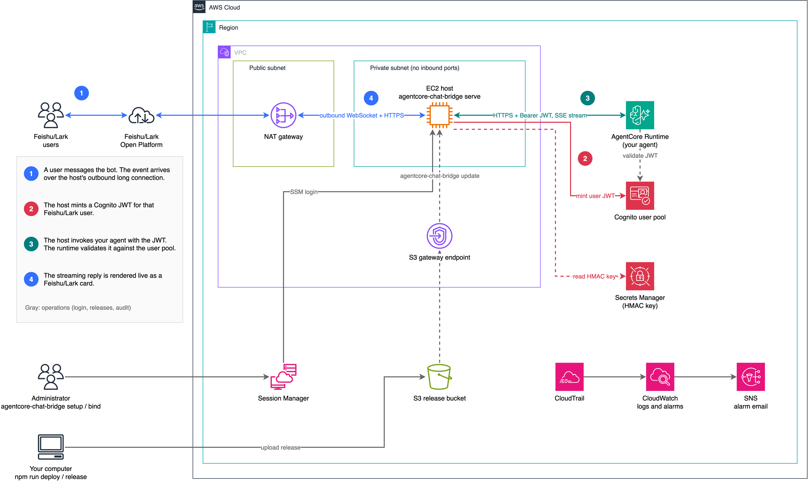

[English](README.md) | 简体中文

# 面向 Amazon Bedrock AgentCore 的飞书对话集成

本示例是一个自托管的飞书接入层，面向已经部署在 Amazon Bedrock AgentCore Runtime 上的智能体。AgentCore Runtime 上的智能体没有现成的对话界面，本示例在你账号里的一台 EC2 主机上运行桥接服务来提供这个界面：它和飞书保持一条只出站的长连接，把每个飞书用户映射成一个 Cognito 身份，用该用户的 JWT 调用你的 runtime，并把流式回复实时渲染成飞书卡片。

**智能体由你提供。** 本示例不负责部署或托管智能体，而是绑定一个已有的 AgentCore runtime（使用 Strands Agents 编写，这是目前支持的框架），该 runtime 的授权方式需配置为指向本示例 Cognito 用户池的 JWT。[`examples/strands-agent/`](examples/strands-agent/) 是一个参考智能体，可以部署起来试用。

> **第三方服务**：本代码会与飞书（及其国际版 Lark）交互。服务条款见 https://www.feishu.cn/terms（Lark：https://www.larksuite.com/user-terms-of-service），价格见 https://www.feishu.cn/pricing（Lark：https://www.larksuite.com/pricing）。继续之前，请先了解相关价格，并确认你的使用场景符合这些条款。

> **示例代码声明**：本项目是示例，用于演示如何把 AgentCore Runtime 上的智能体接入飞书，不是可直接用于生产的产品。部署到生产环境前，请按你所在组织的安全和合规要求自行评审（身份与权限、数据保留、日志、网络、依赖漏洞扫描等）。

- 设计文档（英文）：[`docs/design.md`](docs/design.md)
- 参考智能体：[`examples/strands-agent/`](examples/strands-agent/)
- 智能体开发指南（英文，配合本机器人需要满足的要求、各项能力的写法）：[`docs/agent-guide.md`](docs/agent-guide.md)

## 架构



1. 用户在飞书里给机器人发消息。事件经由一条 WebSocket 长连接到达主机，这条连接由主机通过 NAT 网关主动向外建立。主机没有公网 IP，也没有入站端口。
2. 主机把飞书用户映射成一个 Cognito 用户（密码由 Secrets Manager 中的 HMAC 密钥派生），并为该用户获取一个短时效的 access token。
3. 主机通过 HTTPS 调用你的 AgentCore runtime，把 token 作为 Bearer JWT 携带，并以 SSE（server-sent events）流读取回复。runtime 用 Cognito 用户池校验 token，智能体从 token 中读取用户身份。
4. 主机把流式回复实时渲染成飞书卡片。

运维：管理员通过 SSM Session Manager 登录主机执行 `agentcore-chat-bridge` 命令。发布包从你的电脑上传到 S3 存储桶，主机通过 S3 网关端点拉取。CloudTrail 为签发 token 的 Cognito API 调用提供 CloudWatch 告警，告警通过 SNS 邮件通知你。

（图中 runtime 调用画成直连，实际上也经由 NAT 网关出 VPC。）

## 功能

**注册与绑定**

- `agentcore-chat-bridge setup` 用官方设备码授权注册飞书机器人：扫一次码即可创建应用，并预填权限、事件和卡片回调。扫码人成为管理员。
- 一台主机可以服务多个机器人。每个机器人可以按别名绑定多个 AgentCore runtime（指定 ARN 和 endpoint qualifier），管理员用 `/agent` 切换；一个 runtime 也可以被多个机器人绑定。
- `bind --verify` 在绑定生效前检查 runtime 的授权配置。新增机器人无需重启服务。
- `/newbot` 在飞书里直接注册一个复用当前智能体的新机器人。

**对话**

- 私聊，以及群聊中 @ 机器人的消息。
- 输入：文本、富文本、引用回复、图片、文件（默认单个不超过 20 MB，每轮合计不超过 50 MB、最多 5 个）、合并转发的聊天记录。
- 流式卡片：回复边生成边渲染，带可折叠的思考过程、工具调用列表、token 用量、**重新生成**按钮，以及跳转到 CloudWatch 控制台 AgentCore Observability 的**查看 Trace**按钮。
- 人工确认：智能体在敏感工具调用前触发 Strands interrupt 时，卡片显示选项按钮，用户点击后智能体继续执行。
- 会话：每个用户有自己的 AgentCore runtime 会话。`/new` 开始新对话，`/resume` 切回最近的对话，`/retry` 重发上一条消息。同一会话内的轮次串行执行，后来的消息排队。
- 智能体可以拿到用户的显示名称和稳定的用户 ID（`feishu:<tenant_key>:<union_id>`，由已校验的 JWT 携带），用于个性化回复，以及按用户隔离 AgentCore Memory 等数据。

**管理**

- 访问控制：管理员与允许名单（按 union_id、邮箱或手机号添加），或 `allowAll`。名单外的人给机器人发消息时，管理员会收到带**允许** / **拒绝**按钮的申请卡片。
- 定时任务：`/schedule add 工作日 09:00 <提示词>` 按计划运行提示词并把结果发到会话中。
- 按机器人和智能体统计用量：轮次、成功率、活跃用户、token、延迟（飞书里用 `/usage`，主机上用 `agentcore-chat-bridge usage`）。
- 主机运维：`status`、`logs`、`restart`，带校验的原地升级（`update`），以及不中断服务的 HMAC 密钥轮换（`rotate-secret`）。

**安全**

- 没有入站端口和公网 IP，只能通过 SSM Session Manager 登录。
- 每个绑定使用独立的 Cognito app client，access token 有效期 15 分钟。
- 实例角色的权限仅限本项目的用户池、密钥和发布存储桶；调用 runtime 不需要 IAM 权限。
- 日志不记录消息正文、文件名、AppSecret 或 token。

## 前提

- 一个 AWS 账号和区域；智能体 runtime 必须和机器人主机在**同一账号、同一区域**。
- runtime 的认证方式要配置成 **JWT，指向本项目的 Cognito 用户池**（见下文"配置 runtime"）。IAM 认证的 runtime 不支持。
- 本机：Node.js 24+、AWS CDK 所需凭证、`gpgv`（校验 Node.js 发布签名，macOS：`brew install gnupg`）、AWS CLI + Session Manager 插件。
- 一个飞书企业租户，扫码人需要有创建自建应用的权限。

## 费用

部署会创建以下计费资源，实际费用取决于区域、用量和保留时间，请用 [AWS Pricing Calculator](https://calculator.aws/) 按你的场景估算：

- EC2 `t4g.small`（常驻）和 20 GB gp3 加密根卷，以及每天一次、保留 7 份的 EBS 快照。
- NAT Gateway（不传 `vpcId` 时新建 1 个，按小时和流量计费，通常是固定费用里最大的一项）。复用已有 VPC 时不新建。
- Cognito 用户池（Essentials 套餐，按月活用户计费）、Secrets Manager 密钥、S3 发布桶、存放服务器访问日志的 S3 桶（保留 90 天）、CloudWatch 日志和告警。
- VPC 流日志（只记录被拒绝的流量，仅限新建的 VPC），在 CloudWatch Logs 保留 30 天。
- CloudTrail：不传 `trailLogGroupName` 时新建一个只记管理事件的 trail 和对应的 S3 桶、日志组。
- 智能体 runtime 本身（AgentCore Runtime、模型调用等）的费用不在本项目内。

不用时请按"清理"一节删除资源。

## 部署

```bash
npm ci && npm --prefix infra ci
npm run deploy          # = npm run release（打包）+ cdk deploy（首次需要 cdk bootstrap）
```

`cdk deploy` 的可选 context（`-c key=value`）：

| key | 说明 |
|---|---|
| `vpcId` | 复用已有 VPC（需要带 NAT 出站的私有子网和 S3 网关 endpoint）；不传则新建 |
| `releaseWriterArns` | 允许写发布桶的 IAM 主体（逗号分隔），给 `npm run release -- --upload` 用 |
| `alarmEmail` | 告警邮件 |
| `trailLogGroupName` | 复用已有 CloudTrail 的日志组；不传则新建一个只记管理事件的 trail |

部署输出里有 `SsmCommand`、`UserPoolId`、`DiscoveryUrl`、`ReleaseBucketName`。

## 注册机器人

```bash
aws ssm start-session --target <实例 ID>             # 部署输出 SsmCommand
agentcore-chat-bridge setup [--runtime-arn <arn>] [--app-name 名称]
```

终端显示二维码（和链接），用飞书 App 扫码并确认。`setup` 使用官方 SDK 的设备码授权（`registerApp`）创建应用，按 [`setup/scopes.json`](setup/scopes.json) 预填权限、事件和卡片回调，拿到 AppID / AppSecret；随后校验凭证，把扫码人设为管理员（存 `union_id`），并执行绑定的第一阶段。

`setup` 结束后，到飞书开放平台打开这个应用（终端会打印链接），确认事件和回调的订阅方式为"长连接"、版本已发布、权限已开通。之后运行 `agentcore-chat-bridge status`，长连接应显示为已连接。

如果应用是你在开放平台手动创建的，用 `setup --verify <appId>` 登记（会要求输入 AppSecret）。

新应用默认只对扫码人可见、只有管理员能对话。在开放平台调整可见范围；在 `/var/lib/agentcore-feishu-bot/bots.json` 里配置 `allowedUsers`（union_id）或 `allowAll: true`，然后 `agentcore-chat-bridge restart`。

## 配置 runtime（客户侧）

`setup` / `bind` 为每次绑定新建一个 Cognito app client，并打印 runtime 需要的配置：

```jsonc
"authorizerConfiguration": {
  "customJWTAuthorizer": {
    "discoveryUrl": "https://cognito-idp.<region>.amazonaws.com/<userPoolId>/.well-known/openid-configuration",
    "allowedClients": ["<这次绑定的 app client id>"]
  }
},
"requestHeaderConfiguration": { "requestHeaderAllowlist": ["Authorization"] }
```

用 `UpdateAgentRuntime`（或 AgentCore CLI）配置后，在主机上：

```bash
agentcore-chat-bridge bind --verify <appId> [别名]     # 检查通过后绑定变为"可用"
```

> **迁移指引**：runtime 的 JWT 认证和 IAM 认证**互斥**，改成 JWT 后新版本不再接受 SigV4 调用（认证配置随版本固化，已实测）。如果还有其他程序用 IAM 调用它：
> 1. **推荐**：用同一镜像另建一个 JWT 认证的 runtime 给机器人使用，原 runtime 不动；
> 2. 过渡：先建一个 endpoint 钉在当前版本、让 IAM 调用方改用它，再把 runtime 改成 JWT。钉住的 endpoint 代码冻结在该版本。
>
> 工具不会替你修改 runtime。

智能体从 `context.request_headers["Authorization"]` 读 access token，用其中的 `username`（= `feishu:<tenant_key>:<union_id>`）作为用户身份，不要信任 payload 里的 `actorId`。参考实现见 [`examples/strands-agent/`](examples/strands-agent/)。

## 主机命令

| 命令 | 作用 |
|---|---|
| `list` / `status` | 机器人、绑定状态、长连接状态、活跃会话 |
| `bind <appId> [--runtime-arn] [--qualifier] [--alias]` | 增加一个智能体（两阶段） |
| `bind --verify <appId> [别名]` | 检查 runtime 配置 |
| `unbind <appId> <别名>` | 删除绑定和 app client（之后请从 runtime 的 `allowedClients` 中移除） |
| `remove <appId>` | 删除机器人配置（不删飞书应用，请在开放平台停用） |
| `admin add\|remove <appId> <union_id\|邮箱\|手机号>` / `admin list <appId>` | 管理员 |
| `allow add\|remove <appId> <union_id\|邮箱\|手机号>` / `allow list <appId>` / `allow all <appId> on\|off` | 可对话用户 |
| `usage [appId] [--days 7]` | 用量统计 |
| `rotate-secret [--apply]` | HMAC 密钥轮换（先在自己电脑写入新版本） |
| `restart` / `logs` | 重启服务 / 看日志 |
| `update` | 升级到发布桶里的新版本 |

飞书里的命令：

| 命令 | 权限 | 说明 |
|---|---|---|
| `/new` | 可对话用户 | 和当前智能体开始新对话 |
| `/resume [编号]` | 可对话用户 | 列出最近的对话 / 切回某段对话 |
| `/retry` | 可对话用户 | 重发上一条消息 |
| `/status` | 可对话用户 | 当前智能体、会话、用量 |
| `/agent [别名]` | 管理员 | 列出 / 切换智能体（切回时接着上次的对话） |
| `/schedule add\|list\|remove` | 管理员 | 定时任务，例如 `/schedule add 工作日 09:00 总结昨天的新闻`。时间规则：`每天 HH:MM`、`工作日 HH:MM`、`每周一 HH:MM`、`每 N 分钟`（N >= 10）、`每 N 小时`，也可以用英文 `daily` / `weekdays` / `every mon` / `every N minutes` / `every N hours` |
| `/usage [天数]` | 管理员 | 本机器人的用量统计 |
| `/newbot [名称]` | 管理员，私聊 | 注册一个新机器人，沿用当前智能体 |
| `/help` | 所有人 | 列出命令 |

不在名单里的人给机器人发消息时，会自动向管理员发送使用申请卡片（管理员点"允许"即加入名单）；在 `bots.json` 里设 `"accessRequests": false` 可关闭。

## 升级

```bash
# 本机：改 package.json 版本号后
npm run release -- --upload --bucket <ReleaseBucketName>
# 主机：
agentcore-chat-bridge update
```

`update` 下载、校验 sha256、检查包内条目（只允许普通文件和目录）、用包内 `SHA256SUMS` 校验，然后切换版本并重启；任一步失败保留旧版本。不需要重新 `cdk deploy`。

## HMAC 密钥轮换

Cognito 用户的密码由 HMAC 密钥派生。服务认证时先用 `AWSCURRENT`、失败后用 `AWSPREVIOUS` 试一次，所以轮换中途不中断：

1. **在自己电脑上**用管理员凭证写入新版本（主机的实例角色没有写权限）：
   ```bash
   aws secretsmanager put-secret-value --secret-id <HmacSecretArn> --secret-string "$(openssl rand -base64 48 | tr -d '/+=')"
   ```
2. 主机上 `agentcore-chat-bridge rotate-secret --apply`：为用户池里所有用户重设成新密钥派生的密码，然后让服务换用新密钥。中途失败可以直接重跑。不带 `--apply` 只显示用户数和步骤。

## 主机被攻破后的处置

1. 停实例（`aws ec2 stop-instances`）。
2. 轮换 HMAC 密钥（上一节），并对所有用户执行 `AdminUserGlobalSignOut`（使 refresh token 失效）。
3. 在开放平台轮换各机器人的 AppSecret，更新 `bots.json`。
4. 已签出的 access token **无法提前作废**（runtime 离线验签），最多 15 分钟后过期。需要立即止损时，临时从 runtime 的 `allowedClients` 中移除相应 client。
5. 查看 CloudTrail 告警（`AdminInitiateAuth` / `AdminCreateUser` / `AdminSetUserPassword` 调用量突增，或来自实例角色以外身份的调用）。

## 清理

```bash
npm --prefix infra run cdk -- destroy
```

`destroy` 会删除 EC2 主机、安全组、VPC（仅限新建的）、告警、DLM 策略等。以下资源**设置了保留策略，不会被删除**，需要自己确认不再使用后手动清理：

| 资源 | 说明 |
|---|---|
| Cognito 用户池 | 开了 `deletionProtection`。先在控制台或用 `aws cognito-idp update-user-pool --deletion-protection INACTIVE` 关闭保护，再删除 |
| Secrets Manager 密钥（HMAC） | 用 `aws secretsmanager delete-secret` 删除（默认有恢复窗口） |
| S3 发布桶 | 开了版本控制，需要先清空所有版本和删除标记，再删桶 |
| CloudWatch 日志组（CloudTrail） | 在控制台或用 `aws logs delete-log-group` 删除 |
| CloudTrail 的 S3 桶 | 不传 `trailLogGroupName` 时由 CDK 新建，清空后删除 |
| S3 访问日志桶 | 存放发布桶和 CloudTrail 桶的服务器访问日志，清空后删除 |
| EBS 快照 | DLM 策略删除后，已有快照不会被自动清理 |

另外：

1. 在飞书开放平台停用或删除 `setup` 创建的应用（`agentcore-chat-bridge remove` 只删本机配置）。
2. 如果配置过 runtime 的 `allowedClients`，请移除对应的 Cognito app client，必要时把 runtime 的认证方式改回原来的配置。

## 本机开发

```bash
npm test                         # 单元测试
npm run typecheck && npm run lint
bash test/host/run.sh            # 主机脚本的容器测试（需要 docker / podman，先 npm run release）

# 用本机 AWS 凭证和单独的数据目录（默认 ./.data）跑服务
npm run cli -- init-config --user-pool-id <id> --hmac-secret-arn <arn>
npm run cli -- setup --verify <手工创建的测试应用 appId> --runtime-arn <arn>
npm run dev
```

日志不记录消息正文、AppSecret、token。服务不开任何入站端口。

## 安全

参见 [CONTRIBUTING](CONTRIBUTING.md#security-issue-notifications)。

## 许可证

本项目以 MIT-0 许可证发布，见 [LICENSE](LICENSE)。

部分实现改编自第三方软件，见 [THIRD-PARTY-LICENSES](THIRD-PARTY-LICENSES)。
